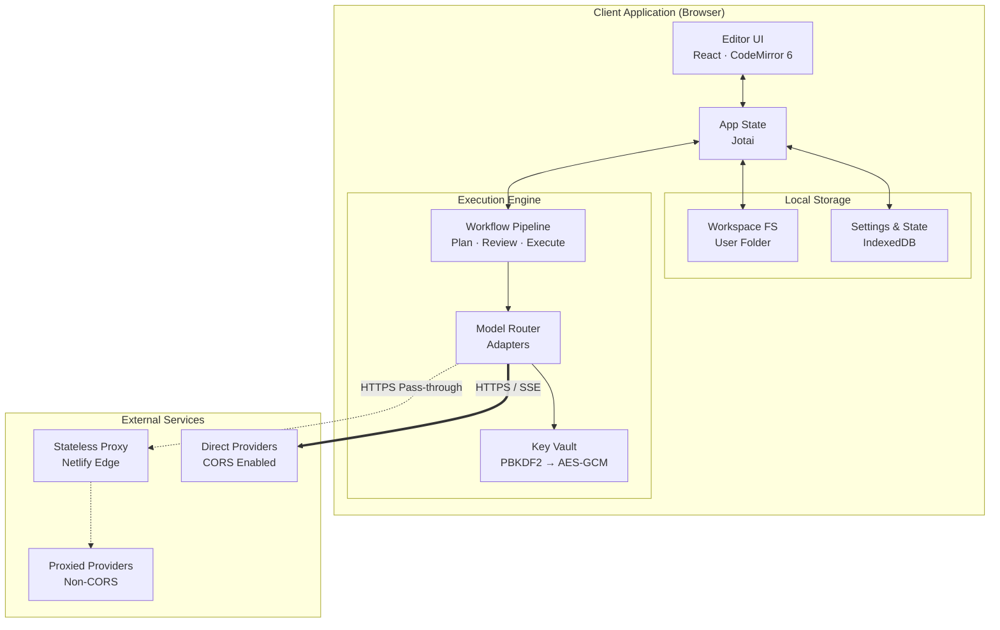
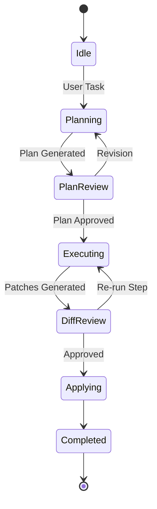

Daedalus IDE is a static, browser-only code editor with an integrated Bring-Your-Own-Key (BYOK) AI engine operating on a three-stage pipeline: **Plan → Review → Execute**.

All compute, file storage, key handling, and LLM calls run in the client. Hosting is static asset delivery via CDN, supplemented by an optional stateless edge proxy for endpoints requiring CORS bypass.

---

## Core Principles

- **Client Execution:** Zero backend databases or persistent servers. Direct browser-to-provider calls form the primary network path.
- **Local Ownership:** Each workspace is backed by a folder the user picks through the File System Access API. API keys reside encrypted at rest and decrypt only into memory closures.
- **Human-in-the-Loop:** Generative output acts as transient proposals. Workspace mutations require explicit user confirmation via diff review.
- **Tiered Model Routing:** Tasks dispatch to models optimized for specific phases (e.g., reasoning models for planning, fast/cheap models for execution).
- **Distraction-Free UX:** Single-pane editor with collapsible panels and command-palette controls.

---

## Technical Stack

| Layer | Technology | Purpose |
| :--- | :--- | :--- |
| **Framework** | Vite + React + TypeScript | Static SPA bundle with strict type contracts |
| **Styling** | Tailwind CSS | CSS-variable design tokens and theme engine |
| **Editor** | CodeMirror 6 | Modular document engine and diff views |
| **State** | Jotai | Atomic state management to isolate streaming renders |
| **Storage** | File System Access API folder (workspace files), IndexedDB (settings/sessions/vault) | High-capacity local workspace filesystem |
| **Crypto** | Web Crypto API | PBKDF2 key derivation and AES-GCM vault encryption |
| **Hosting** | Netlify Static Edge | Global CDN distribution and security header enforcement |

---

## Architecture Diagram

## Key Subsystems

### Key Vault
 * Derivation: Passphrase derived via PBKDF2-SHA-256 (≥ 600,000 iterations).
 * Encryption: Provider keys encrypted with AES-GCM-256.
 * Memory Safety: Decrypted keys reside in private module memory, never in React state or local storage.

### Provider Adapters & Proxy
 * All providers implement a standard streaming interface (listModels, stream).
 * Direct communication is used whenever supported by the provider.
 * The Edge Proxy (netlify/edge-functions/llm-proxy.ts) acts as a stateless CORS pass-through with no logging or data persistence.

### Workflow Pipeline

 * Plan: Collects context (open files, workspace summary, rules) and outputs a structured step-by-step plan.
 * Review: User edits, reorders, or approves plan steps.
 * Execute & Apply: Steps execute sequentially to produce diff patches (FilePatch[]). Approved patches apply atomically to the workspace folder with snapshot history for undo.

### Vim Mode

Vim mode is the default editing interface, provided by `@replit/codemirror-vim`, and can be disabled in Settings or the Command Palette. The preference is persisted under `daedalus.vimMode`.

- `jk` and `jj` are mapped to Escape in insert mode.
- App chords such as `Mod-B`, `Mod-K`, and `Mod-S` are passed through to the window so the command palette and shortcuts keep working.
- `:` opens a glass Ex prompt at the bottom of the editor (`cm-vim-panel`).
- On the blank page, `:` is routed to the Vim prompt instead of starting an untitled file.

Ex commands are wired to workspace actions:

| Command | Action |
| :--- | :--- |
| `:w` | Save the active buffer |
| `:q` | Save and close the active tab |
| `:q!` | Discard changes and close the active tab |
| `:wq` | Save and close |
| `:bd` | Close the active tab |
| `:e <path>` | Open an existing file by exact or unique fuzzy path |
| `:bnext` / `:bprev` | Cycle to the next or previous tab |
| `:Explore` / `:Ex` / `:E` / `:Sexplore` / `:Vexplore` | Open and focus the file tree |
| `:grep [text]` / `:gr` | Open live grep, optionally with a starting query |
| `:Gdiffsplit` / `:DiffviewOpen` / `:DiffviewClose` | Open the file diff review (split or unified) or close it |
| `:BranchReview [base]` / `:BR [base]` | Open the branch review against `base` (default `main`, then `master`) |
| `:BRNext` / `:BRPrev` | Next or previous file of the branch review |
| `:BRMarkReviewed` | Mark the current branch-review file reviewed and advance |
| `:BRReset` | Clear all reviewed marks of the open branch review |

Each Ex command is registered under its full name, because `Vim.defineEx` throws unless the short name is a prefix of the name. Matching is case-sensitive, so `:BRN` is not a command.

### Diff Review

`DiffReview` (`src/review/DiffReview.tsx`) is an overlay that replaces the editor and shows the active file against HEAD, unified or split. Git is read with isomorphic-git (`GitService`, `src/workspace/gitService.ts`) through the linked folder; hunks come from `computeHunks` (`src/review/diff.ts`). Keys: `]c` / `[c` hunks, `]f` / `[f` files, `s` / Space stage, `X` / `u` revert, `dp` / `do` put / obtain, `q` / Esc close. The shared decorations and theme live in `src/review/diffView.ts`.

### Branch Review

`:BranchReview` (or `Mod-Shift-B`) opens `BranchReview` (`src/review/branch/BranchReview.tsx`): a file index on the left and the patch of one file on the right, for the cumulative changeset `merge-base(base, HEAD)..HEAD`. Uncommitted work is not included.

- **Git.** `GitService.resolveBase` (branch, remote ref, short oid, annotated tag), `branchChanges` (tree walk that skips equal subtrees and submodules; renames show as A plus D) and `readBlobAt` (text, binary, or over 1 MB). Line totals are computed in the background with `computeHunks`.
- **Reviewed marks** are stored in localStorage under `daedalus.branchReview.<workspaceId>.<base>.<branch>`, per path with the base and HEAD blob oids. A mark counts only while both oids still match, so a changed file shows as unreviewed again. `:BRReset` clears them.
- **Keys.** Index: `j` / `k` select, `n` / `L` next (marks the file left behind), `p` / `H` previous, `a` / Space toggle reviewed and advance, `r` / `X` revert the file, `e` edit, `q` / Esc close, `Ctrl-W w` swap focus with the patch. Patch: `]c` / `[c` hunks, `sa` approve the hunk (this session only), `sr` revert the hunk. Reverts ask for `y` first, write to the working tree through the editor buffer (undoable), and match the hunk against the live text before editing.
- Binary files and files over 1 MB show a placeholder; clicking it shows blob ids and sizes.

### Live Grep

`Mod-Shift-F` (also `:grep` and the palette command "Search: Live Grep in Files") opens a Telescope-style finder: type to search file contents across the workspace, with a context preview, and Enter jumps to the line (`controller.openFileAt`). Ctrl-N/P/J/K move the selection.

It is built so typing never touches disk:

- **Warm index.** `GrepService` (`src/workspace/grepService.ts`) reads files in the background as soon as the tree loads and ships the bytes to a Web Worker (`grep.worker.ts`), where `GrepIndex` (`grep.ts`) holds decoded text. Without `Worker` (tests) the same index runs in-process.
- **Fast search.** Native `indexOf` over the text, smart case (any uppercase makes the query exact), one hit per line, and line numbers computed only for hits. A query that extends the previous one rescans only the files the previous one matched.
- **Responsive.** The search yields every ~10 ms; a new keystroke cancels it. Results stream in batches, open tabs are searched first, and the list is virtualized. The cap is 500 hits (100 per file).
- **Bounded.** Skipped: `.git`/`node_modules` (pruned by `FolderFS`), images and other binary extensions, files over 1 MiB, files with NUL bytes, and everything past 200 MB of text (the finder says the index is partial). Reads use a concurrency of 2 because `FolderFS` serializes calls and a user action must not queue behind the whole index.
- **Fresh.** `refreshTree` and tree patches diff entries by path and size; saves call `touch(path)`. A file edited outside the app with an unchanged size is picked up on the next change to it or when the workspace is reopened.
- **Read-only.** Grep reads only the linked folder through `WorkspaceFS` and renders results as text, never as HTML.

### Worktree Sidebar

The sidebar is an extension of the paper, not a developer dashboard. It is quiet, typographic, and secondary to the editor canvas.

**Layout.** A flush-left, canvas-colored overlay, 240 px wide (`w-sidebar`; 200 px, `w-sidebar-compact`, below 1280 px), full height, separated by a 1 px `line` divider. No shadow, no radius, no blur. It overlays the editor, so opening it never moves the editor column.

**Header (36 px).** The linked folder name in uppercase 11 px mono (`muted`). New file, Collapse all and Close buttons appear on hover or focus. There is no floating edge chevron.

**Toggles.** `:Explore` (and its variants), `Mod-B`, and the command palette open the tree. `q` closes it. `Ctrl-W W` toggles focus between the tree and the editor without closing the tree. `Ctrl-R` refreshes the workspace. The sidebar closes automatically below 1024 px, and when the editor is clicked or receives keyboard input.

**Tree.** Typographic, not an icon tree.
 * 28 px rows, 12 px indentation per level, faint `line` guide lines.
 * No file-type icons. One subtle chevron per folder, rotating 90° when open.
 * The active file uses a `surface` background with `font-medium` text; other rows are `muted`.
 * Dirty buffers carry a 4 px `accent` dot at the row's right edge.
 * Dirty state comes from `openBuffersAtom`; folders above a dirty file show the dot too.
 * No per-row action buttons. Rename and delete go through keys and the context menu.

**Keyboard** follows a netrw-style scheme. Arrow-key equivalents remain available for accessibility.

 | Key | Action |
 | :--- | :--- |
 | `j` / `k` or `Up` / `Down` | Move between rows |
 | `gg` / `G` or `Home` / `End` | Jump to the first or last row |
 | `Enter` / `l` | Open a file, or expand a folder |
 | `h` / `-` | Collapse a folder, or jump to the parent folder |
 | `a` | Create a file in the focused row's directory |
 | `A` | Create a folder in the focused row's directory |
 | `r` / `F2` | Rename the focused row inline |
 | `d` / `D` / `Delete` | Ask for inline deletion confirmation |
 | `y` | Copy the workspace-relative path to the clipboard |
 | `Y` | Copy the workspace-rooted absolute path (`/path`) to the clipboard |
 | `Ctrl-R` | Refresh the workspace tree |
 | `Ctrl-W W` | Toggle focus between the tree and the editor |
 | `q` | Close the sidebar |
 | `Shift+F10` | Open the row context menu |

**Finder.** A compact, softly surfaced input with a small top inset, in the Apple style: no heavy border until focused, then a faint accent ring. It filters the tree in place.

**Linked folder.** The picked folder is the source of truth for the workspace. It is surfaced only when it needs attention: when readwrite permission lapses, a quiet "Not connected" row with Reconnect appears. There is no app-side mirror. Listing is read-first: the tree is shown whenever the browser allows reading, and write access is requested separately via Reconnect, so a lapsed edit grant keeps the files visible read-only instead of hiding them.

**Footer (28 px).** 10 px mono. The storage engine on the left (`Folder`, `File`, or `—`) and key hints on the right. File count and size sit in the tooltip. A footnote, not a status bar. `workspaceTreeAtom` and `activeFileIdAtom` alias `treeAtom` and `activePathAtom`.

**Conflicts resolved against the original spec.** `Enter` renames in the spec; here `Enter` opens a file or toggles a folder, as in every file tree, and `F2` renames, so both actions stay reachable. The spec's `fs.worker.ts`, OPFS and IndexedDB engine are not used: storage is folder-only. Per-row action buttons are omitted in favor of netrw-style tree keys.

## Security Policy

Security is enforced via strict Content Security Policy headers:
