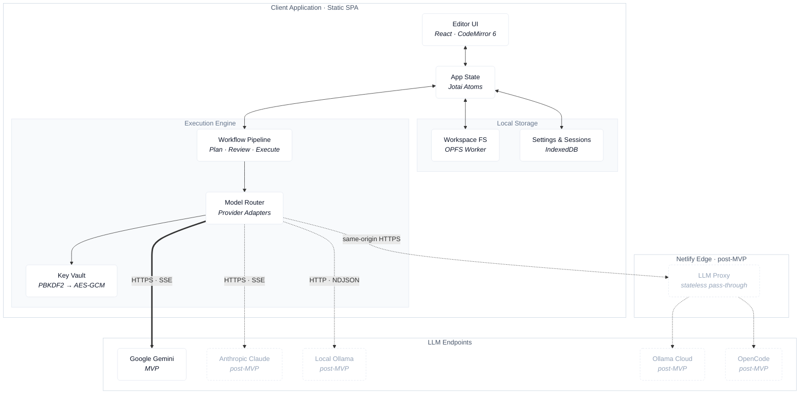
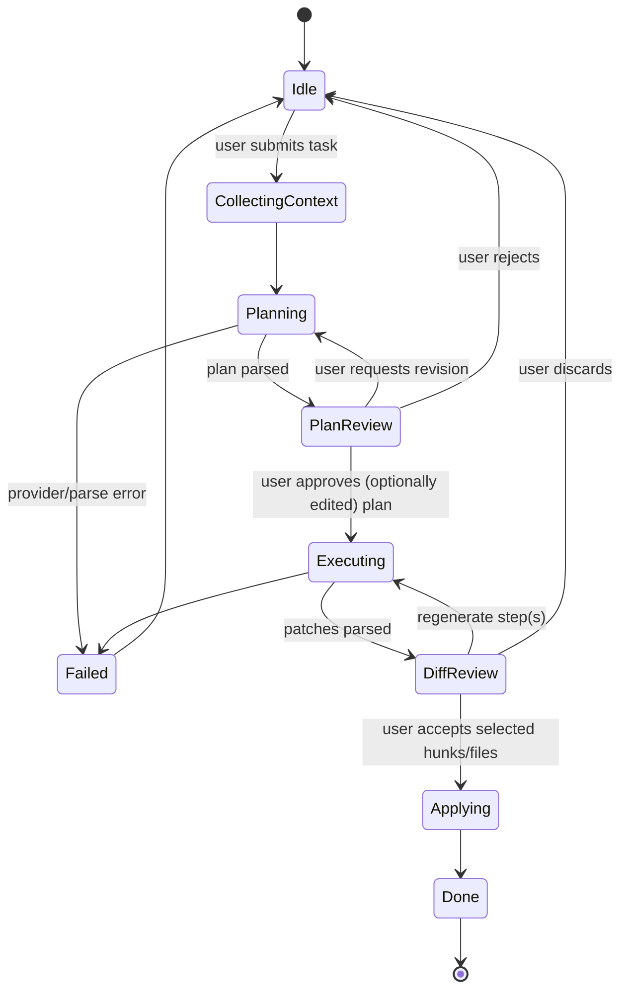

# Architecture

This document describes how Daedalus IDE is built: a static, browser-only code editor with a Bring-Your-Own-Key (BYOK) AI companion that works in three steps: **Plan → Review → Execute**.

The MVP has no backend. The browser handles all compute, file storage, key handling and LLM calls, and Netlify only serves the static files. After the MVP, one small stateless proxy is planned for providers whose APIs reject browser requests (§5.5.1).

---

## 1. Design Constraints

| Constraint | Consequence |
| --- | --- |
| Zero backend | No database and no server-side secrets. In the MVP there's no proxy either; every provider must accept direct browser (CORS) requests. Post-MVP, one exception is planned: a stateless Edge Function proxy, used only for providers that block browser requests (§5.5.1). |
| Privacy / local ownership | Workspace files live in OPFS. Keys are stored encrypted and only decrypted in memory. |
| Human-in-the-loop | Generated changes are proposals until the user approves them. Nothing is written to the workspace without an explicit approval. |
| Cost-optimized | Each workflow phase gets its own model. Cheap models are the default (Gemini Flash-tier in the MVP; local Ollama at $0 post-MVP). |
| Distraction-free | One pane by default. Panels (files, AI, diff) are hidden until summoned. |

### 1.1 MVP Scope

| Area | MVP | Post-MVP |
| --- | --- | --- |
| AI provider | **Google Gemini** (BYOK key), used for both Plan and Execute | Anthropic (direct), local Ollama (direct), Ollama Cloud and OpenCode (via proxy) |
| Backend | None | One stateless Edge Function proxy (§5.5.1) |
| Router | Model choice per phase, budget guards, retry with backoff | Cross-provider fallback chains |
| Browsers | Chrome, Edge, Firefox, Safari | Local Ollama won't work in Safari |

Everything else in this document (editor, OPFS workspace, vault, Plan → Review → Execute) is in the MVP. The provider interface is generic from day one, so adding providers later doesn't touch the workflow code.

---

## 2. System Overview



---

## 3. Technology Stack

| Layer             | Choice                       | Rationale                                                                                |
| :---------------- | :--------------------------- | :--------------------------------------------------------------------------------------- |
| Build / framework | Vite + React + TypeScript    | Static SPA output, fast HMR, typed contracts between modules.                            |
| Styling           | Tailwind CSS v4              | Semantic design tokens as CSS variables (§5.8), light/dark themes, little CSS to maintain. |
| Editor            | CodeMirror 6                 | Modular and light; language packages load on demand; `@codemirror/merge` provides diffs. |
| State             | Jotai                        | Atomic updates keep re-renders small during token streaming.                             |
| File storage      | OPFS                         | Fast, origin-scoped file storage that needs no permission prompts.                       |
| Settings storage  | IndexedDB (`idb-keyval`)     | Settings, session state, encrypted key blobs, and a fallback when OPFS is missing.       |
| Crypto            | Web Crypto (`crypto.subtle`) | Native PBKDF2 and AES-GCM; no third-party crypto code.                                   |
| Hosting           | Netlify                      | Static CDN, SPA redirects, security headers via `netlify.toml`.                          |

---

## 4. Source Layout

```
src/
  app/                 # App shell, layout, command palette, keybindings
  styles/              # tokens.css (design tokens, §5.8), fonts, Tailwind @theme mapping
  ui/                  # Design-system primitives: Panel, GlassPopover, Chip, IconButton, Kbd
  editor/              # CodeMirror setup, extensions, themes, language loading
    extensions/        # focus mode, typewriter scrolling, diff decorations
  workspace/           # File tree UI + FS service facade
    fs.worker.ts       # OPFS access (sync access handles) in a dedicated worker
    fs.ts              # Promise-based client for the worker (Comlink-style RPC)
    fallback-idb.ts    # IndexedDB-backed FS when OPFS is unavailable
  vault/               # Key vault: derive, encrypt, decrypt, lock/unlock
  providers/           # LLM provider adapters behind a common interface
    types.ts
    gemini.ts          # MVP
    anthropic.ts       # post-MVP
    ollama.ts          # post-MVP: local Ollama, and Ollama Cloud through the proxy
    openai-compat.ts   # post-MVP: OpenCode through the proxy
  router/              # Phase → provider/model resolution, budget guards
  workflow/            # Plan / Review / Execute state machine
    context.ts         # Context collection (selected files, tree summary)
    plan.ts            # Plan prompt + schema + parser
    execute.ts         # Execute prompt + diff/patch parser
    apply.ts           # Atomic application of approved patches to the FS
  review/              # Plan reviewer + diff viewer UI
  state/               # Jotai atoms (workspace, editor, workflow, settings)
  lib/                 # Shared utilities (streaming, abort, hashing, errors)
netlify/
  edge-functions/
    llm-proxy.ts       # post-MVP: stateless proxy for providers that block browser requests
```

---

## 5. Components

### 5.1 Editor UI

- **Default shell:** one centered CodeMirror pane with a constrained line width and no visible chrome. The file tree, AI panel and diff viewer open as overlays or a split, from the command palette (`Mod-K`) or shortcuts.
- **Focus mode:** a CodeMirror extension that dims everything except the current line, paragraph or code block, like iA Writer.
- **Typewriter scrolling:** optional; keeps the cursor line vertically centered.
- **Typography:** a monospace family for code and prose (self-hosted, e.g. iA Writer Mono / JetBrains Mono, with a system monospace fallback) and the native system sans stack for UI chrome. Monochrome syntax theme in which weight and opacity carry meaning before color does. Full rules in §5.8.
- **Language support:** `@codemirror/language-data` loads parsers lazily, so the initial bundle stays small.

### 5.2 State Management (Jotai)

Atoms are grouped by domain:

- `workspaceAtoms`: file tree, open buffers, dirty flags, active file.
- `editorAtoms`: per-buffer `EditorState` refs (CodeMirror owns document state; Jotai holds references and metadata, not the full text, so keystrokes do not trigger React renders).
- `workflowAtoms`: current workflow run (phase, plan, patches, stream buffers, errors).
- `settingsAtoms`: theme, typography, provider and model per phase, budgets. Persisted to IndexedDB with `atomWithStorage` and a custom IDB storage.
- `vaultAtoms`: lock state and which providers are configured. **Never persisted.** Decrypted keys are kept outside Jotai (see §5.4).

Streaming tokens are appended to a dedicated atom, and updates are batched with `requestAnimationFrame` so only the streaming view re-renders.

### 5.3 Workspace Persistence (OPFS)

- **Layout:** `/workspaces/<workspaceId>/...` mirrors the user's project tree. `/meta/<workspaceId>.json` holds workspace metadata.
- **Access:** all OPFS I/O runs in a dedicated Web Worker that uses `FileSystemSyncAccessHandle`. This is the most widely supported and fastest OPFS path, including Safari. The main thread calls the worker over a typed RPC.
- **Writes:** each file write goes to `<name>.tmp` and is then renamed (or overwritten from the temp handle), so an interrupted write cannot leave a truncated file.
- **Import/Export:** import from a folder (`showDirectoryPicker` where available, or `<input webkitdirectory>`) or from a `.zip`. Export as a `.zip`.
- **Fallback:** if OPFS is unavailable (older browsers, some private modes), a `fallback-idb.ts` adapter with the same `FileSystem` interface stores files as IndexedDB records.

```ts
interface WorkspaceFS {
  list(dir: string): Promise<Entry[]>;
  read(path: string): Promise<string>;
  write(path: string, content: string): Promise<void>;
  remove(path: string): Promise<void>;
  rename(from: string, to: string): Promise<void>;
  applyPatchSet(patches: FilePatch[]): Promise<ApplyResult>; // all-or-nothing
}
```

### 5.4 Key Vault (BYOK)

The PRD's "AES-GCM key derivation" works in two steps: **PBKDF2** derives a wrapping key from a passphrase, and **AES-GCM** encrypts the provider keys with it.

1. **Setup:** the user picks a vault passphrase. A random 16-byte salt is generated, then `PBKDF2-SHA-256` (≥ 600,000 iterations) derives a non-extractable `AES-GCM-256` `CryptoKey`.
2. **Store:** each provider key is encrypted with a fresh 12-byte IV. IndexedDB stores `{ salt, iterations, iv, ciphertext, provider }`. Plaintext is never written anywhere.
3. **Unlock:** at session start the user enters the passphrase. The derived key decrypts the provider keys into memory (a module-scoped `Map`, not React state and not devtools-visible atoms).
4. **Lock:** manual lock, auto-lock after idle timeout, and lock on `pagehide`. Locking clears the in-memory map.
5. **Optional "remember on this device":** stores a non-extractable `CryptoKey` in IndexedDB so the user does not have to type the passphrase. Convenient, but weaker protection; off by default, and the UI says so.

**Threat model, stated plainly:** the vault protects keys at rest, for example against a copied browser profile or casual inspection. It cannot protect keys from XSS or malicious extensions running in the page while the vault is unlocked. The strict CSP (§8) is the main defense against XSS.

### 5.5 Provider Adapters

All providers implement one streaming interface:

```ts
interface LLMProvider {
  id: 'gemini' | 'anthropic' | 'ollama' | 'ollama-cloud' | 'opencode';
  listModels(): Promise<ModelInfo[]>;
  stream(req: ChatRequest, signal: AbortSignal): AsyncIterable<ChatChunk>;
  estimateCost?(req: ChatRequest): CostEstimate;
}
```

| Provider | Status | Path | Endpoint | Auth | Notes |
| --- | --- | --- | --- | --- | --- |
| Gemini | **MVP** | Direct | `https://generativelanguage.googleapis.com/v1beta/models/{model}:streamGenerateContent?alt=sse` | `x-goog-api-key` header (not the `?key=` query param, so keys stay out of URLs/logs) | SSE stream. Model list from `GET /v1beta/models`. |
| Anthropic | Post-MVP | Direct | `https://api.anthropic.com/v1/messages` | `x-api-key` header | Requires the `anthropic-dangerous-direct-browser-access: true` header. SSE stream. |
| Ollama (local) | Post-MVP | Direct | `http://localhost:11434/api/chat` | none | User sets `OLLAMA_ORIGINS` to the app origin. Chromium may ask for local network access. Safari blocks it as mixed content. |
| Ollama Cloud | Post-MVP | Proxy | `https://ollama.com/api/chat` | `Authorization: Bearer` | Same NDJSON format as local Ollama, so it reuses `ollama.ts` with a different base URL. |
| OpenCode | Post-MVP | Proxy | `https://opencode.ai/inference/v1/chat/completions` | `Authorization: Bearer` | OpenAI-compatible SSE. The model list (`/inference/v1/models`) allows browser requests, but chat doesn't. |

**Browser access (CORS) results, tested 2026-11-03** with preflight requests from a `*.netlify.app` origin:

| Endpoint | Preflight result | Browser-direct? |
| --- | --- | --- |
| `generativelanguage.googleapis.com` | 200, origin allowed, `x-goog-api-key` allowed | Yes |
| `api.anthropic.com/v1/messages` | 200, `*`, required headers allowed | Yes |
| `ollama.com/api/*` | 405, no CORS headers | No → proxy |
| `opencode.ai/inference/v1/{chat/completions,messages,responses}` | 404, no CORS headers | No → proxy |

Adapters convert each provider's stream format (SSE events or NDJSON) into a common `ChatChunk` (`text`, `usage`, `done`, `error`). Every request gets an `AbortSignal`, so the user can cancel it at any time.

#### 5.5.1 Planned: LLM Proxy (post-MVP)

This is a single Netlify Edge Function, `netlify/edge-functions/llm-proxy.ts`, mounted at `/api/llm/:provider/*`. It exists only to reach providers whose APIs reject browser requests. Providers that accept them, such as Gemini and Anthropic, never go through it.

- **Fixed list of upstreams:** `ollama-cloud → https://ollama.com/api/*` and `opencode → https://opencode.ai/inference/v1/*`. Anything else gets a 404, so it can't be used as an open relay.
- **Pass-through only:** it forwards the method, the body, `Authorization` and `Content-Type`, and streams the upstream response back unchanged. It drops cookies and all other headers.
- **Stores nothing:** no logging of headers or bodies, and no storage. The user's key comes from the browser vault on each request and exists in the function only while that request runs.
- **Abuse limits:** only same-origin requests are accepted (`Origin` / `Sec-Fetch-Site` check), a Netlify rate-limit rule applies, request bodies have a size cap, and only the chat and model-list endpoints are allowed.
- **Cost:** Edge Functions are billed as web requests plus outbound bandwidth, not compute. That's roughly 450 LLM calls per Netlify credit, an estimate based on ~100 KB streamed per response.
- **Netlify limits:** 50 ms CPU per request (time spent waiting on the upstream doesn't count) and 40 s for the first response header to arrive. Streaming pass-through fits both.
- **CSP:** the proxy is same-origin, so it's already covered by `connect-src 'self'`. No new origins are needed.
- **Trust change:** keys for proxied providers pass through our function. The UI marks those providers as "via Daedalus proxy", and the README states it plainly.

### 5.6 Model Router

The router turns `(phase, settings)` into `(provider, model, params)`:

- **MVP defaults (Gemini only):** Plan uses a Gemini Flash model, chosen for its large context window and low input cost. Execute uses the cheapest Flash-tier model available, such as Flash-Lite. Users can pick any model from the Gemini model list for each phase. Model IDs aren't hardcoded; defaults are picked from `listModels()` by tier.
- **MVP retry:** on 429/5xx the router retries with exponential backoff (max 3). After that the run moves to `Failed`, and the user can retry or switch models.
- **Post-MVP fallback chain:** with more providers, the router can try the next configured provider when the primary is unreachable or rate-limited. It asks first if that provider costs money. The PRD's cost-optimized split (Execute on local Ollama at $0) becomes available at that point.
- **Budget guards:** a token estimate (character count heuristic) runs before each request. If it exceeds the per-request or per-session limit, the user must confirm. Actual usage from provider responses is recorded per session in IndexedDB.

### 5.7 Workflow Engine (Plan → Review → Execute)

The workflow is an explicit state machine (a hand-rolled reducer). Each step is serializable, so the user can resume a run after a reload.



**Phase 1: Plan**
- Context: the user's task, the selected and open files, a compact file-tree summary, and optional project notes (`.daedalus/context.md`).
- Output contract: Markdown with a fenced JSON block that conforms to a `Plan` schema (validated with Zod):
  ```ts
  type Plan = {
    summary: string;
    steps: { id: string; description: string; files: { path: string; action: 'create' | 'modify' | 'delete' }[] }[];
    dependencies?: { name: string; reason: string }[];
    risks?: string[];
  };
  ```
- If the JSON does not validate, the engine makes one automatic repair request, then shows the raw output.

**Phase 2: Review (plan)**
- The plan appears as an editable checklist: the user can reorder, edit, or delete steps, or add free-text notes. The edited plan is what Execute receives.
- Actions: **Approve**, **Revise** (re-plan with the user's feedback), **Reject**.

**Phase 3: Execute**
- One request per plan step (or batched for small steps). Each request contains only the files that step touches, which keeps per-request context, and therefore cost, small.
- Output contract: full-file replacements for new or small files; search/replace blocks for edits to large files. The parser checks that every search block matches exactly once in the current file content, otherwise it rejects the block.
- Patches stay in memory as `FilePatch[]` and nothing touches OPFS yet.

**Phase 2b: Review (diff)**
- `@codemirror/merge` shows a side-by-side or unified diff per file. The user can accept or reject individual hunks or whole files.
- **Apply:** accepted patches are applied with `applyPatchSet`, which is all-or-nothing. It first takes a snapshot, so **Undo last AI change** can restore the previous contents.

### 5.8 Design System

The look combines the typographic focus of iA Writer, macOS/iOS-style materials, and Tailwind CSS for implementation.

**Principles**
- **Focus first:** the editor is the workspace. Chrome (sidebars, toolbars, metadata) recedes until hovered or toggled.
- **Tactile simplicity:** subdued monochrome palettes, generous whitespace, one sharp accent for focus states, subtle backdrop blur on floating surfaces.
- **Typographic rhythm:** a strict column width and a comfortable line height.

**Tokens.** Colors are defined once as CSS variables in `src/styles/tokens.css` (`:root` for light, `.dark` for dark) and mapped to Tailwind through `@theme`. Components use semantic names (`bg-canvas`, `text-muted`, `border-line`, `bg-accent`), never raw hex values. Dark mode is class-based, with the system preference as default.

| Token | Light | Dark | Usage |
| --- | --- | --- | --- |
| `canvas` | `#FFFFFF` | `#121212` | Editor background, sidebar |
| `surface` | `#F8F9FA` | `#1A1A1A` | Popovers, command palette, active tree row (`bg-accent/10` tints it) |
| `text` | `#18181B` | `#E4E4E7` | Code and primary text |
| `muted` | `#71717A` | `#8E8E96` | Metadata, paths, status bar, chevrons. Passes AA on canvas and surface. The spec values (`#A1A1AA` / `#52525B`, about 2.5:1) fail AA. |
| `line` | `#E4E4E7` | `#27272A` | Hairlines and dividers. Tree guide lines use `line` at 40% opacity. |
| `accent` | `#2563EB` | `#60A5FA` | Active tab underline, cursor, selection tint, active tree tint, modified-file dot |
| `diff-add` | bg `color-mix(#16A34A 14%, canvas)`, fg `#15803D` | bg `color-mix(#4ADE80 16%, canvas)`, fg `#4ADE80` | Added lines |
| `diff-remove` | bg `color-mix(#DC2626 12%, canvas)`, fg `#B91C1C` | bg `color-mix(#F87171 16%, canvas)`, fg `#F87171` | Removed lines |

Contrast is checked by a token test (see IMPLEMENTATION_PLAN.md, Testing Strategy), not by eye. The spec's solid `#16A34A` on white is 3.3:1, so it is used only as a background tint or a non-text mark.

Diff colors and prose secondary shades are set in the design-revision tasks (IMPLEMENTATION_PLAN.md, M6b) and checked by the contrast test.

**Typography**
- Editor and code: self-hosted IBM Plex Mono (`@fontsource`, `font-display: swap`), then `ui-monospace, SFMono-Regular, Menlo, Monaco, Consolas, monospace`. The spec lists JetBrains Mono or Fira Code as examples; IBM Plex Mono is already bundled, so it stays unless the user asks for a swap.
- Base size 14 px, line height 1.65 (`leading-relaxed`), user-adjustable in settings (default 15 px allowed).
- UI and controls: `-apple-system, BlinkMacSystemFont, "SF Pro Text", "Inter", sans-serif`. Tree names and workspace name are 13 px; status bar is 11 px monospace.
- Editor column: `max-w-[72ch]` (about 70–80 characters), centered, padding `py-12 px-8`. Width and line height are user-adjustable in settings.

**Layout.** Full-viewport flex row with three regions:
- **Sidebar (worktree):** 240 px fixed, flush left (200 px compact option in settings). Contains the worktree tree only, with New File and New Folder in a small toolbar. Workspace switching and archive (zip) actions are not in the sidebar. Switching happens from the workspace opener, and zip import is a drop onto the opener. Translucent canvas with a hairline right border.
- **Center canvas:** `flex-1`, centered editor column. Padding `py-12 px-8`.
- **Top buffer:** 40 px high (36 px compact). Tab bar on the left, breadcrumb centered, status and actions on the right. Border-bottom is transparent until hover or focus-within.

The sidebar is the file tree overlay. The active file item uses `surface` with a `bg-accent/10` tint and `font-medium`.

**Conflict resolutions** (spec vs. earlier sections of this document):
- Sidebar `w-64` (256 px) → 240 px. Header 48 px → 40 px. The spec value wins.
- Gutter line numbers: the spec shows them faintly and hides them in focus mode. Earlier text said "no visible chrome". Resolution: the gutter is shown in `muted` at 70% opacity, hidden in focus mode. Provisional; confirm with the user.
- `Mod-K` in focus mode: the spec says it restores chrome, but `Mod-K` opens the command palette. Resolution: chrome is restored by pointer movement, `Esc`, or any keyboard focus inside chrome. `Mod-K` only opens the palette.
- `Mod-W` (close tab): browsers reserve it, so pages cannot reliably intercept it. Resolution (provisional): close via the tab `x`, middle-click, and a palette command. The keyboard shortcut is `Mod-Alt-W` until a better one is chosen.
- Tree single-key shortcuts (`A`, `Shift+A`, `F2`) only apply when the tree has focus. They must never type into the editor.

**Interactions**
- **Focus mode (chrome):** while typing, non-essential chrome fades out (`opacity-0`, 300 ms) and returns on pointer movement. This is separate from the editor's line/paragraph dimming in §5.1. Both are disabled under `prefers-reduced-motion` (instant, no transition), and chrome stays visible when it holds keyboard focus.
- **Cursor:** solid 2 px bar in `accent` (CodeMirror `cursor` theme). Selection uses `accent` at 20% (light) / 30% (dark).
- **Glass panels:** popovers, status chips, the command palette and model drawers use `backdrop-blur-md` with `canvas`/white at about 70% opacity. Provide an opaque fallback when `backdrop-filter` is unsupported, and keep text contrast above AA on the blended background.

**Implementation notes**
- The CodeMirror theme reads the same CSS variables (`var(--color-accent)` etc.), so one token change updates the editor and the UI together.
- Shared primitives live in `src/ui/`. Feature modules compose them and don't redefine colors.
- **Buttons:** every action button uses `Button` (`src/ui/Button.tsx`) with `variant` (`primary`, `secondary`, `ghost`, `danger`), `size` (`sm`, `md`), and an optional `icon`. Icon-only actions use `IconButton`, which is `Button` with a required `label` for the accessible name and tooltip. Feature code must not write button classes. List rows, tabs and cards are not action buttons and keep their own layout.
- Tailwind's `dark:` variant is only needed for exceptions, since tokens already switch with the theme class.
- Backdrop blur and inline styles need no CSP changes.

---

## 6. Data Model (IndexedDB stores)

| Store | Key | Value |
| --- | --- | --- |
| `settings` | `'app'` | theme, typography, router config, budgets |
| `vault` | provider id | `{ salt, iterations, iv, ciphertext }` |
| `workspaces` | workspace id | name, created/updated, last open files, source key (hash of the imported folder or zip name and file layout; re-opening the same key switches to the existing workspace instead of duplicating it) |
| `runs` | run id | serialized workflow state (task, plan, patches, usage) |
| `snapshots` | run id | pre-apply file contents for undo |
| `fs-fallback` | `workspaceId:path` | file contents (only when OPFS unavailable) |

---

## 7. Error Handling

- **Network/provider errors:** normalized into `ProviderError { kind: 'auth' | 'rate_limit' | 'network' | 'cors' | 'server' | 'aborted', retryable }`. A Gemini `auth` error links to key settings. Post-MVP, a `cors` or `network` error on local Ollama shows setup instructions (`OLLAMA_ORIGINS`).
- **Parse errors:** one repair attempt, then the raw output is shown so the user can edit it or retry.
- **FS errors:** `applyPatchSet` rolls back from the snapshot if any write fails.
- **Quota:** `navigator.storage.estimate()` is shown in settings. On first workspace creation the app calls `navigator.storage.persist()`.

---

## 8. Security

### 8.1 Content Security Policy

CSP is the main defense for the vault, so it is strict. **Note:** the PRD's `netlify.toml` has Markdown link syntax inside the CSP string (`[https://...](https://...)`), which would produce an invalid header. The corrected MVP policy:

```
default-src 'self';
script-src 'self' 'wasm-unsafe-eval';
style-src 'self' 'unsafe-inline';
font-src 'self';
img-src 'self' data: blob:;
worker-src 'self' blob:;
connect-src 'self' https://generativelanguage.googleapis.com;
object-src 'none';
base-uri 'self';
form-action 'none';
frame-ancestors 'none';
```

- `connect-src` allows only the providers that have shipped. Each post-MVP direct provider adds its own origin when it ships: `https://api.anthropic.com`, then `http://localhost:11434` for local Ollama. Proxied providers need nothing new, because the proxy is `'self'`.
- `style-src 'unsafe-inline'` is required because CodeMirror injects styles at runtime.
- No third-party scripts, analytics, or CDN-hosted fonts.

### 8.2 Other Measures

- Model output is never rendered as raw HTML. Markdown is rendered with a sanitizing renderer (`react-markdown` without `rehype-raw`).
- Generated code is never executed. The app only edits text.
- Keys are never logged, never placed in URLs, and are cleared when the vault locks.
- Dependencies are pinned and audited (`npm audit` in CI).

---

## 9. Deployment

Static build (`vite build` → `dist/`) deployed to Netlify. See `netlify.toml`:

```toml
[build]
  publish = "dist"
  command = "npm run build"

[[redirects]]
  from = "/*"
  to = "/index.html"
  status = 200

[[headers]]
  for = "/*"
  [headers.values]
    X-Frame-Options = "DENY"
    X-Content-Type-Options = "nosniff"
    Referrer-Policy = "strict-origin-when-cross-origin"
    Permissions-Policy = "camera=(), microphone=(), geolocation=()"
    Content-Security-Policy = "default-src 'self'; script-src 'self' 'wasm-unsafe-eval'; style-src 'self' 'unsafe-inline'; font-src 'self'; img-src 'self' data: blob:; worker-src 'self' blob:; connect-src 'self' https://generativelanguage.googleapis.com; object-src 'none'; base-uri 'self'; form-action 'none'; frame-ancestors 'none'"

[[headers]]
  for = "/assets/*"
  [headers.values]
    Cache-Control = "public, max-age=31536000, immutable"
```

Post-MVP, the proxy adds an `edge_functions` declaration for `/api/llm/*`. Netlify doesn't apply `[[headers]]` rules to Edge Function responses, so the function sets its own security headers.

---

## 10. Browser Support

| Feature | Chrome/Edge | Firefox | Safari |
| --- | --- | --- | --- |
| OPFS (sync access handles in worker) | ✓ | ✓ | ✓ (16.4+) |
| Web Crypto PBKDF2 / AES-GCM | ✓ | ✓ | ✓ |
| Gemini (MVP) | ✓ | ✓ | ✓ |
| Anthropic, proxied providers (post-MVP) | ✓ | ✓ | ✓ |
| Local Ollama from HTTPS origin (post-MVP) | ✓ (may prompt for local network access) | ✓ | ✗ (mixed content) |
| `showDirectoryPicker` import | ✓ | fallback input | fallback input |

---

## 11. Known Trade-offs

- **No real filesystem access:** the workspace lives in OPFS, so the user's actual project folder is not edited in place. Getting code out means exporting a zip, or copying into a real folder on Chromium with the File System Access API (possible future work).
- **Keys in the browser:** BYOK with no proxy means keys exist in page memory while unlocked. This is inherent to the zero-backend design.
- **One provider in the MVP:** shipping with Gemini only means no $0 local execution and no fallback when Gemini is down. In exchange, the MVP has no backend, nothing to install, and works in every browser.
- **Proxy (post-MVP):** reaching Ollama Cloud and OpenCode means user keys pass through a Netlify function. It's stateless and keeps no logs, but it's still a third party in the request path, and it's the only part of Daedalus that isn't purely static.
- **Model quality:** cheap and small models make more mistakes in Execute. The strict patch format, exact-match validation, and diff review are there to contain those mistakes.
