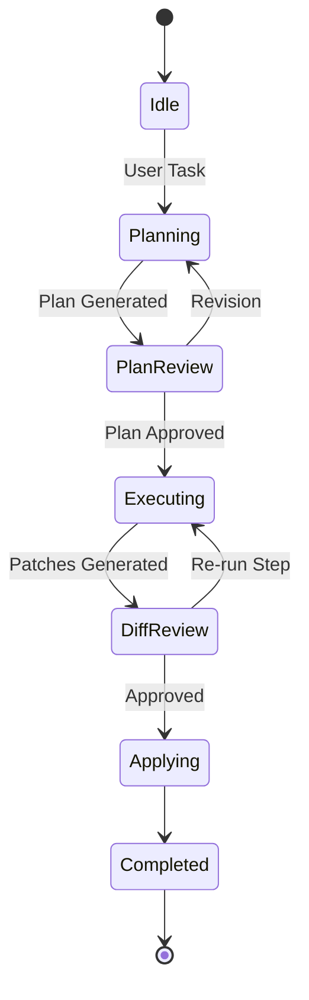

Daedalus IDE is a static, browser-only code editor with an integrated Bring-Your-Own-Key (BYOK) AI engine operating on a three-stage pipeline: **Plan → Review → Execute**.

All compute, file storage, key handling, and LLM calls run in the client. Hosting is static asset delivery via CDN, supplemented by an optional stateless edge proxy for endpoints requiring CORS bypass.

---

## Core Principles

- **Client Execution:** Zero backend databases or persistent servers. Direct browser-to-provider calls form the primary network path.
- **Local Ownership:** Workspace files persist in origin-scoped IndexedDB. API keys reside encrypted at rest and decrypt only into memory closures.
- **Human-in-the-Loop:** Generative output acts as transient proposals. Workspace mutations require explicit user confirmation via diff review.
- **Tiered Model Routing:** Tasks dispatch to models optimized for specific phases (e.g., reasoning models for planning, fast/cheap models for execution).
- **Distraction-Free UX:** Single-pane editor with collapsible panels and command-palette controls.

---

## Technical Stack

| Layer | Technology | Purpose |
| :--- | :--- | :--- |
| **Framework** | Vite + React + TypeScript | Static SPA bundle with strict type contracts |
| **Styling** | Tailwind CSS | CSS-variable design tokens and theme engine |
| **Editor** | CodeMirror 6 | Modular document engine and diff views |
| **State** | Jotai | Atomic state management to isolate streaming renders |
| **Storage** | IndexedDB (`fs-meta`, `fs-blob`) | High-capacity local workspace filesystem |
| **Crypto** | Web Crypto API | PBKDF2 key derivation and AES-GCM vault encryption |
| **Hosting** | Netlify Static Edge | Global CDN distribution and security header enforcement |

---

## Architecture Diagram

## Key Subsystems

### Key Vault
 * Derivation: Passphrase derived via PBKDF2-SHA-256 (≥ 600,000 iterations).
 * Encryption: Provider keys encrypted with AES-GCM-256.
 * Memory Safety: Decrypted keys reside in private module memory, never in React state or local storage.

### Provider Adapters & Proxy
 * All providers implement a standard streaming interface (listModels, stream).
 * Direct communication is used whenever supported by the provider.
 * The Edge Proxy (netlify/edge-functions/llm-proxy.ts) acts as a stateless CORS pass-through with no logging or data persistence.

### Workflow Pipeline

 * Plan: Collects context (open files, workspace summary, rules) and outputs a structured step-by-step plan.
 * Review: User edits, reorders, or approves plan steps.
 * Execute & Apply: Steps execute sequentially to produce diff patches (FilePatch[]). Approved patches apply atomically to IndexedDB with snapshot history for undo.

### Vim Mode

Vim mode is the default editing interface, provided by `@replit/codemirror-vim`, and can be disabled in Settings or the Command Palette. The preference is persisted under `daedalus.vimMode`.

- `jk` and `jj` are mapped to Escape in insert mode.
- App chords such as `Mod-B`, `Mod-K`, and `Mod-S` are passed through to the window so the command palette and shortcuts keep working.
- `:` opens a glass Ex prompt at the bottom of the editor (`cm-vim-panel`).
- On the blank page, `:` is routed to the Vim prompt instead of starting an untitled file.

Ex commands are wired to workspace actions:

| Command | Action |
| :--- | :--- |
| `:w` | Save the active buffer |
| `:q` | Save and close the active tab |
| `:q!` | Discard changes and close the active tab |
| `:wq` | Save and close |
| `:bd` | Close the active tab |
| `:e <path>` | Open an existing file by exact or unique fuzzy path |
| `:bnext` / `:bprev` | Cycle to the next or previous tab |
| `:Explore` / `:Ex` / `:E` / `:Sexplore` / `:Vexplore` | Open and focus the file tree |

### Worktree Sidebar

The sidebar is an extension of the paper, not a developer dashboard. It is quiet, typographic, and secondary to the editor canvas.

**Layout.** A flush-left, canvas-colored overlay, 240 px wide (`w-sidebar`), full height, separated by a 1 px `line` divider. No shadow, no radius, no blur. It overlays the editor, so opening it never moves the editor column.

**Header (40 px).** A single `Files` label in `muted`. The expand-all / collapse-all toolbar buttons and the floating edge chevron were removed; the tree is driven by keyboard commands instead.

**Toggles.** `:Explore` (and its variants), `Mod-B`, and the command palette open the tree. `q` closes it. `Ctrl-W W` toggles focus between the tree and the editor without closing the tree. `Ctrl-R` refreshes the workspace. The sidebar closes automatically below 1024 px, and when the editor is clicked or receives keyboard input.

**Tree.** Typographic, not an icon tree.
 * 28 px rows, 12 px indentation per level, faint `line` guide lines at 40% opacity.
 * No file-type icons. One subtle chevron per folder, rotating 90° when open.
 * The active file uses a `surface` background with `font-medium` text; other rows are `muted`.
 * Dirty buffers carry a 4 px `accent` dot at the row's right edge.
 * No expand-all or collapse-all controls, and no per-row action buttons.

**Keyboard** follows a netrw-style scheme. Arrow-key equivalents remain available for accessibility.

 | Key | Action |
 | :--- | :--- |
 | `j` / `k` or `Up` / `Down` | Move between rows |
 | `gg` / `G` or `Home` / `End` | Jump to the first or last row |
 | `Enter` / `l` | Open a file, or expand a folder |
 | `h` / `-` | Collapse a folder, or jump to the parent folder |
 | `a` | Create a file in the focused row's directory |
 | `A` | Create a folder in the focused row's directory |
 | `r` / `F2` | Rename the focused row inline |
 | `d` / `D` / `Delete` | Ask for inline deletion confirmation |
 | `y` | Copy the workspace-relative path to the clipboard |
 | `Y` | Copy the workspace-rooted absolute path (`/path`) to the clipboard |
 | `Ctrl-R` | Refresh the workspace tree |
 | `Ctrl-W W` | Toggle focus between the tree and the editor |
 | `q` | Close the sidebar |
 | `Shift+F10` | Open the row context menu |

**Finder.** A compact, softly surfaced input with a small top inset, in the Apple style: no heavy border until focused, then a faint accent ring. It filters the tree in place.

**Linked folder.** Surfaced only when it needs attention. The normal connected state is implicit in the workspace header, so there is no "Writes to …" line; when permission lapses, a quiet "Not connected" row with Reconnect appears. Write-back itself is unchanged.

**Footer.** One 10 px mono line: the storage backend (IndexedDB), the file count, and the aggregate file size. A footnote, not a status bar.

**Conflicts resolved against the original spec.** `Enter` renames in the spec; here `Enter` opens a file or toggles a folder, as in every file tree, and `F2` renames, so both actions stay reachable. The spec's per-row action buttons and bulk expand/collapse toolbar are omitted in favor of netrw-style tree keys. The spec's "OPFS" label is `IndexedDB`, because OPFS was dropped: its sync access handles are exclusive per file, so two tabs cannot share a workspace.

## Security Policy

Security is enforced via strict Content Security Policy headers:
