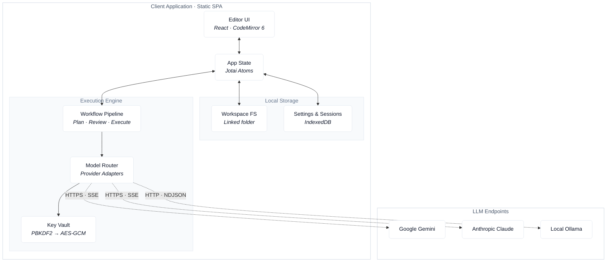

# DaedalusIDE

> **Distraction-free AI engineering in the browser.** A minimalist, local-first code workspace powered by a BYOK (Bring-Your-Own-Key) tiered model architecture and an isolated client-side execution loop.

## Overview

**DaedalusIDE** is a lightweight, browser-based development environment engineered for focused, cost-optimized software craft. Built on top of **CodeMirror 6**, **React**, and the **File System Access API**, it delivers a local-first workspace with zero server overhead.

Instead of running autonomous AI agents that burn through API budgets, DaedalusIDE uses a structured **Plan \\rightarrow Review \\rightarrow Execute** workflow. High-context models map out architectural blueprints, which you review visually before running execution tasks through cheap or local models (e.g., Ollama or Gemini Flash).

## Core Architecture

DaedalusIDE runs 100% client-side as a static Single Page Application (SPA), requiring no backend servers or intermediate proxy layers.



## Key Features

- **Distraction-Free Workspace:** Minimal, typography-first interface built for focused code editing and planning.
- **BYOK Key Management:** Provider keys (Anthropic, Google Gemini, OpenCode, Ollama) stay encrypted on your device using native Web Crypto (`AES-GCM` + `PBKDF2`).
- **Cost-Optimized Tiered Pipeline:**
  - **Plan:** Generate implementation blueprints using high-reasoning models (Gemini Flash, Claude 3.5 Sonnet, DeepSeek).
  - **Review:** Visually inspect diffs, logic breakdowns, and file operations before executing code modifications.
  - **Execute:** Apply changes using zero-cost local LLMs (`Ollama`) or low-cost cloud models.
- **Linked Folders:** Edit files in place in a folder you pick; nothing is copied.
- **Zero Backend Dependency:** Static asset hosting via Netlify CDN; network calls go straight from client to provider APIs.

## Getting Started

### Prerequisites

- **Node.js:** `>=18.0.0`
- **Package Manager:** `npm` or `pnpm`

### Installation

1. **Clone the repository:**

   ```
   git clone https://github.com/your-username/daedalus-ide.git
   cd daedalus-ide
   ```

2. **Install dependencies:**

   ```
   npm install
   ```

3. **Start the local development server:**

   ```
   npm run dev
   ```

4. Open your browser and navigate to `http://localhost:517

## Tech Stack

- **UI & Framework:** React, Tailwind CSS
- **Editor Core:** CodeMirror 6
- **State Management:** Jotai
- **Storage:** File System Access API (linked folder), IndexedDB for metadata
- **Security:** Web Crypto API (`SubtleCrypto`)
- **Hosting:** Netlify CDN

## License

MIT © [Mares Popa](https://marespopa.com)